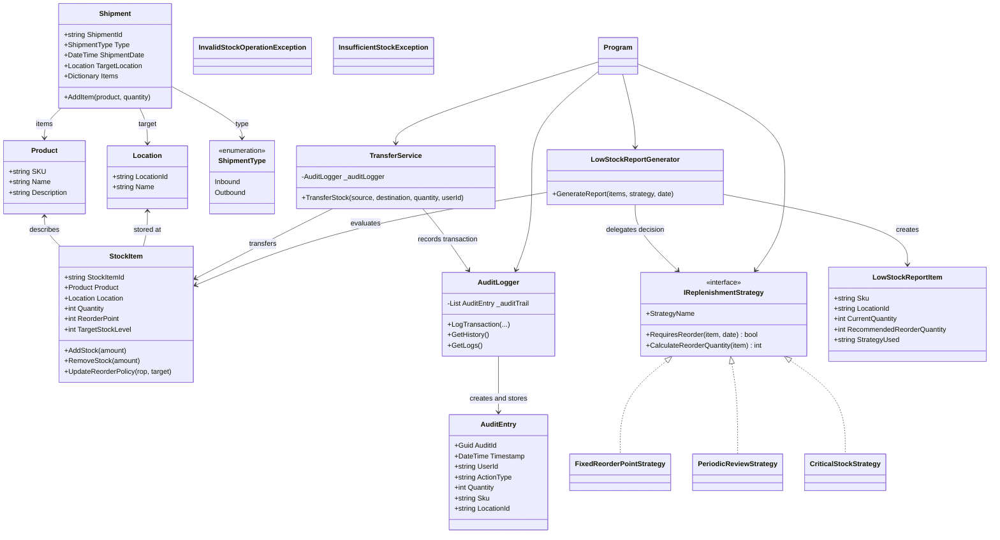
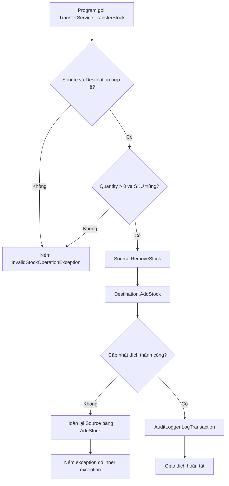
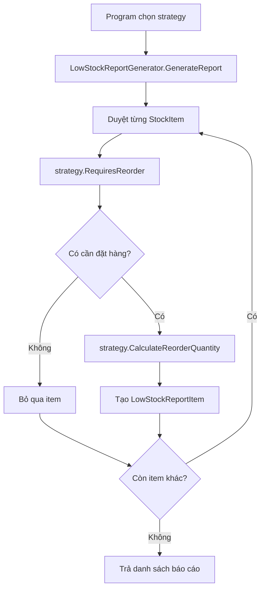

# WarehouseInventory

Hệ thống quản lý tồn kho mẫu được xây dựng bằng **C# và .NET 8**. Dự án minh họa các nguyên tắc lập trình hướng đối tượng, đóng gói dữ liệu, xử lý ngoại lệ, ghi nhật ký giao dịch, Strategy Pattern, đa hình và khả năng mở rộng chính sách tái đặt hàng.

> README này dành cho cả người mới xem repository: tài liệu giới thiệu cấu trúc dự án, giải thích từng class, mô tả quan hệ giữa các thành phần và hướng dẫn clone, build, test, chạy ứng dụng.

---

## Mục lục

- [1. Tổng quan](#1-tổng-quan)
- [2. Chức năng](#2-chức-năng)
- [3. Công nghệ và yêu cầu](#3-công-nghệ-và-yêu-cầu)
- [4. Cấu trúc repository](#4-cấu-trúc-repository)
- [5. Kiến trúc và quan hệ giữa các class](#5-kiến-trúc-và-quan-hệ-giữa-các-class)
- [6. Giải thích chi tiết từng class](#6-giải-thích-chi-tiết-từng-class)
- [7. Các luồng nghiệp vụ](#7-các-luồng-nghiệp-vụ)
- [8. Cài đặt và chạy](#8-cài-đặt-và-chạy)
- [9. Chạy từng nhóm kiểm thử](#9-chạy-từng-nhóm-kiểm-thử)
- [10. Mở rộng bằng strategy mới](#10-mở-rộng-bằng-strategy-mới)
- [11. Giới hạn hiện tại và hướng phát triển](#11-giới-hạn-hiện-tại-và-hướng-phát-triển)

---

## 1. Tổng quan

WarehouseInventory mô phỏng một phần nghiệp vụ quản lý hàng hóa trong kho:

1. Mô hình hóa sản phẩm, vị trí kho và lượng tồn của sản phẩm tại từng vị trí.
2. Nhập hoặc xuất hàng thông qua các phương thức có kiểm tra dữ liệu.
3. Chuyển hàng giữa hai kho và ghi lại giao dịch.
4. Đánh giá tồn kho theo các chính sách tái đặt hàng khác nhau.
5. Tạo báo cáo các mặt hàng cần bổ sung.
6. Kiểm thử những quy tắc nghiệp vụ quan trọng bằng xUnit.

Đây là **ứng dụng console phục vụ học tập và minh họa kiến trúc**, chưa phải hệ thống quản lý kho thương mại hoàn chỉnh. Dữ liệu hiện được giữ trong bộ nhớ của tiến trình; repository chưa tích hợp cơ sở dữ liệu, đăng nhập, REST API hay giao diện web.

### Thuật ngữ chính

| Thuật ngữ | Ý nghĩa |
|---|---|
| `Product` | Thông tin định danh và mô tả một loại sản phẩm |
| `Location` | Một kho hoặc vị trí lưu trữ |
| `StockItem` | Bản ghi số lượng của một sản phẩm tại một vị trí, kèm chính sách đặt hàng |
| `SKU` | Mã định danh sản phẩm |
| `ReorderPoint` (ROP) | Ngưỡng tồn kho dùng để kích hoạt đặt hàng trong một số chiến lược |
| `TargetStockLevel` | Mức tồn kho mục tiêu sau khi bổ sung |
| `Audit Log` | Nhật ký ghi nhận hoạt động |
| `Replenishment Strategy` | Chính sách quyết định khi nào cần đặt hàng và đặt thêm bao nhiêu |

**Phân biệt ba mã định danh:** `Product.SKU` nhận diện sản phẩm; `Location.LocationId` nhận diện vị trí; `StockItem.StockItemId` nhận diện bản ghi tồn kho. Ba giá trị này có vai trò khác nhau và không nên dùng thay thế cho nhau.

---

## 2. Chức năng

### 2.1. Quản lý tồn kho

- Tạo bản ghi tồn kho với số lượng ban đầu.
- Nhập thêm hàng bằng `StockItem.AddStock`.
- Xuất hàng bằng `StockItem.RemoveStock`.
- Từ chối số lượng nhập/xuất không hợp lệ và ngăn xuất vượt tồn.
- Cập nhật ngưỡng đặt hàng và mức tồn mục tiêu bằng `UpdateReorderPolicy`.

### 2.2. Chuyển hàng giữa các kho

`TransferService` kiểm tra dữ liệu đầu vào, xác nhận hai bản ghi có cùng SKU, trừ hàng ở kho nguồn, cộng hàng ở kho đích và ghi audit log khi giao dịch hoàn tất.

### 2.3. Tái đặt hàng

Repository có ba implementation của `IReplenishmentStrategy`:

- `FixedReorderPointStrategy`: kiểm tra liên tục theo ROP.
- `PeriodicReviewStrategy`: chỉ đánh giá vào ngày trong tuần được cấu hình.
- `CriticalStockStrategy`: chỉ kích hoạt khi tồn kho xuống mức nguy cấp bằng 50% ROP.

### 2.4. Báo cáo tồn kho thấp

`LowStockReportGenerator` nhận danh sách `StockItem` cùng một strategy. Nó hỏi strategy xem từng mặt hàng có cần đặt hàng không; nếu có, nó tính lượng cần bổ sung và tạo `LowStockReportItem`.

---

## 3. Công nghệ và yêu cầu

| Thành phần | Sử dụng |
|---|---|
| Ngôn ngữ | C# |
| Framework | .NET 8 (`net8.0`) |
| Ứng dụng | Console Application |
| Unit testing | xUnit 2.9.2 |
| Test platform | Microsoft.NET.Test.Sdk 17.12.0 |
| IDE | Visual Studio Code hoặc Visual Studio |

Cần cài **.NET 8 SDK** để restore, build, test và chạy dự án. Kiểm tra SDK bằng:

```bash
dotnet --version
```

---

## 4. Cấu trúc repository

Cấu trúc dưới đây phản ánh các file source và project chính trên nhánh `main`:

```text
WarehouseInventory/
│
├── ConsoleApp/
│   ├── ConsoleApp.csproj
│   └── Program.cs
│
├── Entities/
│   ├── Product.cs
│   ├── Location.cs
│   ├── StockItem.cs
│   ├── Shipment.cs
│   └── AuditEntry.cs
│
├── Exceptions/
│   ├── InsufficientStockException.cs
│   └── InvalidStockOperationException.cs
│
├── Infracstructure/
│   ├── Reporting/
│   │   └── LowStockReportGenerator.cs
│   └── Services/
│       ├── AuditLogger.cs
│       └── TransferService.cs
│
├── Strategy/
│   ├── IReplenishmentStrategy.cs
│   ├── FixedReorderPointStrategy.cs
│   ├── PeriodicReviewStrategy.cs
│   └── CriticalStockStrategy.cs
│
├── Warehouse.Tests/
│   ├── StockItemTests.cs
│   ├── TransferServiceTests.cs
│   ├── ReplenishmentStrategyTests.cs
│   └── Warehouse.Tests.csproj
│
├── Warehouse.Core.csproj
├── WarehouseInventory.sln
└── README.md
```

> **Lưu ý về tên thư mục:** repository hiện đặt thư mục là `Infracstructure` (thiếu chữ “t” so với cách viết tiếng Anh chuẩn `Infrastructure`). Namespace trong code vẫn là `Warehouse.Infrastructure`. README giữ nguyên tên thư mục thực tế để người đọc tìm file được chính xác.

### Các project trong solution

- **`Warehouse.Core.csproj`:** thư viện chứa entity, strategy, exception và các thành phần infrastructure. Project loại trừ mã nguồn trong `ConsoleApp`, `Warehouse.Tests`, `bin` và `obj`.
- **`ConsoleApp/ConsoleApp.csproj`:** ứng dụng thực thi, tham chiếu đến `Warehouse.Core.csproj`.
- **`Warehouse.Tests/Warehouse.Tests.csproj`:** project kiểm thử xUnit, cũng tham chiếu đến `Warehouse.Core.csproj`.

---

## 5. Kiến trúc và quan hệ giữa các class

Có thể chia code thành bốn nhóm trách nhiệm:

1. **Domain Entities:** mô hình hóa dữ liệu và các quy tắc tồn kho cơ bản.
2. **Domain Strategies:** đóng gói các chính sách tái đặt hàng có thể thay thế cho nhau.
3. **Infrastructure:** thực hiện chuyển kho, ghi nhật ký và tạo báo cáo.
4. **Console Application / Tests:** `Program` chạy demo; project xUnit kiểm tra hành vi.

### Sơ đồ class



### Các quan hệ quan trọng

- Một `StockItem` tham chiếu đến một `Product` và một `Location`.
- `TransferService` thao tác trên hai `StockItem` và dùng `AuditLogger` để ghi giao dịch.
- `AuditLogger` tạo và lưu các `AuditEntry`.
- `LowStockReportGenerator` không tự quyết định chính sách đặt hàng. Nó gọi một đối tượng triển khai `IReplenishmentStrategy`.
- `Program` khởi tạo các đối tượng cụ thể và phối hợp các kịch bản demo.

---

## 6. Giải thích chi tiết từng class

### 6.1. Domain Entities

#### 6.1.1. `Product` — `Entities/Product.cs`

**Vai trò:** mô tả một loại sản phẩm trong hệ thống.

| Thuộc tính | Kiểu | Ý nghĩa |
|---|---|---|
| `SKU` | `string` | Mã sản phẩm |
| `Name` | `string` | Tên sản phẩm |
| `Description` | `string` | Mô tả sản phẩm |

Constructor:

```csharp
new Product(string sku, string name, string description = "")
```

Ví dụ:

```csharp
var laptop = new Product(
    "DELL-XPS-15",
    "Dell XPS 15",
    "Laptop Dell");
```

Các property có `private set`, vì vậy code bên ngoài có thể đọc thông tin nhưng không thể gán trực tiếp giá trị mới. Giá trị được khởi tạo qua constructor.

**Liên kết:** `StockItem` sử dụng `Product` để biết bản ghi tồn kho đang quản lý sản phẩm nào. `Shipment` cũng dùng `Product` làm key trong danh sách mặt hàng.

#### 6.1.2. `Location` — `Entities/Location.cs`

**Vai trò:** biểu diễn một kho hoặc vị trí lưu trữ.

| Thuộc tính | Kiểu | Ý nghĩa |
|---|---|---|
| `LocationId` | `string` | Mã vị trí |
| `Name` | `string` | Tên hiển thị |

Constructor:

```csharp
new Location(string locationId, string name)
```

Ví dụ:

```csharp
var mainWarehouse = new Location("KHO-MAIN", "Kho chính");
var subWarehouse = new Location("KHO-SUB", "Kho phụ");
```

**Liên kết:** mỗi `StockItem` tham chiếu đến một `Location`. Khi chuyển hàng, `TransferService` dùng `LocationId` để ghi nhận vị trí nguồn trong audit log.

#### 6.1.3. `StockItem` — `Entities/StockItem.cs`

**Vai trò:** entity trung tâm của nghiệp vụ tồn kho. Một `StockItem` biểu diễn số lượng của một sản phẩm tại một vị trí cụ thể, đồng thời lưu ngưỡng đặt hàng và mức tồn mục tiêu.

| Thuộc tính | Kiểu | Ý nghĩa |
|---|---|---|
| `StockItemId` | `string` | Mã của bản ghi tồn kho |
| `Product` | `Product` | Sản phẩm được lưu |
| `Location` | `Location` | Vị trí lưu sản phẩm |
| `Quantity` | `int` | Số lượng hiện có |
| `ReorderPoint` | `int` | Ngưỡng đặt hàng lại |
| `TargetStockLevel` | `int` | Mức tồn kho muốn đạt sau khi bổ sung |

Constructor:

```csharp
new StockItem(
    string stockItemId,
    Product product,
    Location location,
    int initialQuantity = 0,
    int reorderPoint = 0,
    int targetStockLevel = 0)
```

Ví dụ:

```csharp
var stock = new StockItem(
    "STOCK-MAIN",
    laptop,
    mainWarehouse,
    initialQuantity: 15,
    reorderPoint: 10,
    targetStockLevel: 25);
```

Các phương thức:

**`AddStock(int amount)`**

- Chỉ nhận số lượng lớn hơn 0.
- Nếu `amount <= 0`, ném `InvalidOperationException`.
- Nếu hợp lệ, cộng số lượng vào `Quantity`.

**`RemoveStock(int amount)`**

- Chỉ nhận số lượng lớn hơn 0.
- Nếu `amount <= 0`, ném `InvalidOperationException`.
- Nếu lượng xuất lớn hơn lượng hiện có, ném `InvalidOperationException` với thông tin SKU và vị trí.
- Nếu hợp lệ, trừ số lượng khỏi `Quantity`.

**`UpdateReorderPolicy(int newReorderPoint, int newTargetStockLevel)`**

- ROP không được âm.
- Mức tồn mục tiêu phải lớn hơn hoặc bằng ROP.
- Chỉ khi dữ liệu hợp lệ, hai property mới được cập nhật.

**Đóng gói (Encapsulation):** `Quantity`, ROP và mức mục tiêu có `private set`. Những lớp bên ngoài không thể tùy ý gán số lượng; thay vào đó phải gọi các phương thức nghiệp vụ. Điều này tập trung việc kiểm tra dữ liệu tại entity.

**Liên kết:** `TransferService` gọi `RemoveStock` và `AddStock`; các strategy đọc `Quantity`, `ReorderPoint` và `TargetStockLevel`; report generator đọc dữ liệu để tạo báo cáo.

#### 6.1.4. `ShipmentType` và `Shipment` — `Entities/Shipment.cs`

**`ShipmentType`** là enum biểu diễn loại lô hàng:

- `Inbound`: lô hàng đi vào kho.
- `Outbound`: lô hàng đi ra khỏi kho.

**`Shipment`** mô tả thông tin của một lô hàng:

| Thuộc tính | Ý nghĩa |
|---|---|
| `ShipmentId` | Mã lô hàng |
| `Type` | Loại inbound hoặc outbound |
| `ShipmentDate` | Thời điểm tạo lô, lấy bằng `DateTime.UtcNow` |
| `TargetLocation` | Vị trí đích liên quan đến lô |
| `Items` | Dictionary ánh xạ `Product` sang số lượng |

Constructor tạo một dictionary rỗng. Phương thức `AddItem(Product product, int quantity)`:

1. Từ chối số lượng nhỏ hơn hoặc bằng 0.
2. Nếu dictionary đã chứa product, cộng thêm vào số lượng hiện tại.
3. Nếu chưa có, thêm product với số lượng mới.

Ví dụ:

```csharp
var shipment = new Shipment(
    "SHIP-001",
    ShipmentType.Inbound,
    mainWarehouse);

shipment.AddItem(laptop, 10);
shipment.AddItem(laptop, 5);
// Với cùng đối tượng laptop, số lượng trong Items sẽ là 15.
```

**Phạm vi hiện tại:** `Shipment` mới là mô hình dữ liệu cho lô hàng. Nó chưa gọi `StockItem.AddStock` hoặc `StockItem.RemoveStock`, và chưa được tích hợp vào kịch bản `Program`. Vì vậy, tạo shipment hiện chưa tự làm thay đổi tồn kho.

**Lưu ý về Dictionary:** `Product` hiện không override `Equals` và `GetHashCode`. Do đó, hai object `Product` được tạo riêng biệt nhưng có cùng SKU vẫn được Dictionary xem là hai key khác nhau. Khi thêm cùng mặt hàng nhiều lần vào một shipment, hãy dùng lại cùng một instance `Product`; hoặc bổ sung quy tắc equality theo SKU nếu muốn so sánh theo mã sản phẩm.

#### 6.1.5. `AuditEntry` — `Entities/AuditEntry.cs`

**Vai trò:** một bản ghi mô tả một hoạt động đã được ghi nhận.

| Thuộc tính | Ý nghĩa |
|---|---|
| `AuditId` | GUID được tạo tự động |
| `Timestamp` | Thời điểm ghi nhận |
| `UserId` | Người thực hiện |
| `ActionType` | Loại hành động, ví dụ `TRANSFER` |
| `Quantity` | Số lượng trong giao dịch |
| `Sku` | SKU sản phẩm |
| `LocationId` | Mã vị trí được ghi vào log |

Constructor nhận các thông tin giao dịch và tự tạo `AuditId`.

Các property `Operator`, `Action`, `QuantityDelta` là property tính toán, lần lượt trả về `UserId`, `ActionType`, `Quantity`. Chúng cung cấp tên gọi tương thích, không tạo thêm dữ liệu độc lập.

**Liên kết:** `AuditLogger` tạo `AuditEntry` mỗi khi ghi giao dịch và lưu các bản ghi này trong danh sách nội bộ.

---

### 6.2. Exceptions

#### 6.2.1. `InvalidStockOperationException` — `Exceptions/InvalidStockOperationException.cs`

Custom exception dùng để mô tả thao tác kho không hợp lệ.

Có hai constructor:

```csharp
new InvalidStockOperationException(string message)
new InvalidStockOperationException(string message, Exception innerException)
```

Constructor thứ hai giữ lại exception gốc trong `InnerException`, hữu ích khi một lỗi cấp thấp hơn được bọc lại bằng thông báo nghiệp vụ rõ ràng hơn.

Trong code hiện tại, `TransferService` dùng exception này khi:

- Source hoặc destination là null.
- Số lượng chuyển không lớn hơn 0.
- Hai sản phẩm có SKU khác nhau.
- Có lỗi trong bước cập nhật kho đích và service thực hiện rollback kho nguồn.

#### 6.2.2. `InsufficientStockException` — `Exceptions/InsufficientStockException.cs`

Custom exception dành cho trường hợp không đủ hàng, có các thuộc tính:

- `Sku`: SKU bị ảnh hưởng.
- `AvailableQuantity`: số lượng hiện có.
- `RequestedQuantity`: số lượng được yêu cầu.

Constructor nhận SKU, số lượng khả dụng và số lượng yêu cầu, sau đó tạo thông báo lỗi.

**Quan trọng:** class này hiện tồn tại nhưng chưa được dùng trong luồng `StockItem.RemoveStock`. Code `RemoveStock` hiện ném `InvalidOperationException` trực tiếp khi không đủ hàng. Vì vậy, không nên giả định rằng mọi lỗi thiếu hàng hiện tại đều trả về `InsufficientStockException`.

Hai custom exception này đều kế thừa trực tiếp từ `System.Exception`; `InsufficientStockException` không kế thừa từ `InvalidStockOperationException`.

---

### 6.3. Replenishment Strategies

#### 6.3.1. `IReplenishmentStrategy` — `Strategy/IReplenishmentStrategy.cs`

Đây là interface định nghĩa hợp đồng chung cho mọi chính sách tái đặt hàng.

Mọi strategy phải cung cấp:

- `StrategyName`: tên chính sách.
- `RequiresReorder(StockItem item, DateTime currentDate)`: trả lời có cần đặt hàng hay không.
- `CalculateReorderQuantity(StockItem item)`: tính số lượng cần đặt thêm.

Nhờ interface, `LowStockReportGenerator` không cần biết nó đang làm việc với Fixed, Periodic hay Critical strategy. Nó chỉ cần nhận một đối tượng triển khai `IReplenishmentStrategy`.

#### 6.3.2. `FixedReorderPointStrategy`

**Quy tắc:** đặt hàng khi tồn kho nhỏ hơn hoặc bằng ROP.

```text
RequiresReorder = Quantity <= ReorderPoint
```

Số lượng cần bổ sung:

```text
max(0, TargetStockLevel - Quantity)
```

Ví dụ: Quantity = 8, ROP = 10, Target = 25.

- Vì `8 <= 10`, chiến lược yêu cầu đặt hàng.
- Số lượng đề xuất là `25 - 8 = 17`.

Chiến lược này phù hợp với cách kiểm tra liên tục theo ngưỡng tồn kho.

#### 6.3.3. `PeriodicReviewStrategy`

**Quy tắc:** chỉ đánh giá vào một ngày trong tuần được cấu hình. Constructor mặc định dùng thứ Hai.

```csharp
var strategy = new PeriodicReviewStrategy(DayOfWeek.Monday);
```

Điều kiện đặt hàng trong code:

1. Nếu `currentDate.DayOfWeek` không bằng ngày review, trả về false.
2. Nếu đúng ngày review, yêu cầu đặt hàng khi `Quantity < TargetStockLevel`.

Điểm khác biệt: strategy này so sánh với **TargetStockLevel**, không so sánh trực tiếp với ROP.

Ví dụ:

- Tồn kho 8, Target 25, ngày thứ Hai: cần đặt hàng.
- Tồn kho 8, Target 25, ngày thứ Ba: không đánh giá đặt hàng.
- Tồn kho 25, Target 25, ngày thứ Hai: không cần đặt hàng.

Khi cần đặt hàng, số lượng đề xuất cũng là `max(0, TargetStockLevel - Quantity)`.

#### 6.3.4. `CriticalStockStrategy`

**Quy tắc:** chỉ kích hoạt khi tồn kho ở mức nguy cấp, được đặt bằng 50% ROP.

```text
criticalThreshold = ReorderPoint / 2
RequiresReorder = Quantity <= criticalThreshold
```

Ví dụ với ROP = 10:

- Ngưỡng nguy cấp = 5.
- Quantity = 4 hoặc 5: yêu cầu đặt hàng.
- Quantity = 6 hoặc 8: không yêu cầu đặt hàng.

Số lượng cần bổ sung để đạt Target vẫn là:

```text
max(0, TargetStockLevel - Quantity)
```

**Lưu ý:** phép chia giữa hai số nguyên trong C# làm tròn xuống. Ví dụ ROP = 11 thì `11 / 2 = 5`. Chiến lược này không sử dụng `currentDate` để ra quyết định.

#### So sánh ba chiến lược

| Chiến lược | Điều kiện kích hoạt | Có phụ thuộc ngày? |
|---|---|---|
| Fixed | `Quantity <= ReorderPoint` | Không |
| Periodic | Đúng ngày review và `Quantity < TargetStockLevel` | Có |
| Critical | `Quantity <= ReorderPoint / 2` | Không |

Cả ba đều triển khai cùng interface nhưng có quy tắc ra quyết định khác nhau. Đây là ví dụ về Strategy Pattern và đa hình.

---

### 6.4. Infrastructure Services

#### 6.4.1. `TransferService` — `Infracstructure/Services/TransferService.cs`

**Vai trò:** điều phối việc chuyển một số lượng sản phẩm từ `StockItem` nguồn sang `StockItem` đích.

Constructor nhận một `AuditLogger` và lưu lại trong field `_auditLogger`.

Phương thức chính:

```csharp
TransferStock(
    StockItem? source,
    StockItem? destination,
    int quantity,
    string userId)
```

Trình tự xử lý:

1. Kiểm tra source và destination không null.
2. Kiểm tra quantity lớn hơn 0.
3. So sánh `source.Product.SKU` và `destination.Product.SKU`. Không cho phép chuyển giữa hai SKU khác nhau.
4. Gọi `source.RemoveStock(quantity)`.
5. Thử gọi `destination.AddStock(quantity)`.
6. Nếu bước cập nhật destination ném exception, gọi `source.AddStock(quantity)` để hoàn lại hàng nguồn rồi ném `InvalidStockOperationException` có chứa exception gốc.
7. Nếu chuyển thành công, gọi `AuditLogger.LogTransaction` để ghi hành động `TRANSFER`.

Ví dụ:

```csharp
var logger = new AuditLogger();
var transferService = new TransferService(logger);

transferService.TransferStock(
    sourceStock,
    destinationStock,
    quantity: 5,
    userId: "warehouse-operator");
```

**Về rollback:** code có cơ chế hoàn lại số lượng ở source nếu lời gọi `destination.AddStock` thất bại. Đây là xử lý rollback ở mức logic trong bộ nhớ, không phải transaction của database. `source.RemoveStock` được gọi trước khối `try`; nếu nó thất bại thì destination chưa bị thay đổi. Audit log chỉ được ghi sau khi hai thao tác cập nhật số lượng hoàn tất.

#### 6.4.2. `AuditLogger` — `Infracstructure/Services/AuditLogger.cs`

**Vai trò:** tạo và lưu nhật ký hoạt động trong bộ nhớ.

Field:

```csharp
private readonly List<AuditEntry> _auditTrail;
```

Phương thức:

- `LogTransaction(...)`: tạo `AuditEntry` với `DateTime.UtcNow`, thêm vào danh sách và in một dòng log ra console.
- `GetHistory()`: trả về view chỉ đọc của danh sách bằng `AsReadOnly()`.
- `GetLogs()`: phương thức tương thích, gọi lại `GetHistory()`.

Logger được truyền vào `TransferService`, vì vậy service không phải tự quản lý danh sách log.

**Giới hạn:** audit log hiện chỉ tồn tại trong RAM của tiến trình. Khi ứng dụng kết thúc, danh sách bị mất; chưa có ghi file hoặc database.

---

### 6.5. Reporting

#### 6.5.1. `LowStockReportItem`

Đây là class dữ liệu dùng để biểu diễn một dòng trong báo cáo:

| Property | Ý nghĩa |
|---|---|
| `Sku` | SKU của sản phẩm |
| `LocationId` | Vị trí lưu |
| `CurrentQuantity` | Tồn kho hiện tại |
| `RecommendedReorderQuantity` | Số lượng đề xuất đặt thêm |
| `StrategyUsed` | Tên strategy tạo ra đề xuất |

Class này không tự kiểm tra tồn kho. Nó chỉ chứa kết quả đã được tính.

#### 6.5.2. `LowStockReportGenerator`

**Vai trò:** tạo báo cáo dựa trên danh sách stock item và strategy được truyền vào.

Phương thức:

```csharp
GenerateReport(
    IEnumerable<StockItem> items,
    IReplenishmentStrategy strategy,
    DateTime currentDate)
```

Trình tự:

1. Kiểm tra `items` và `strategy` không null.
2. Tạo danh sách báo cáo rỗng.
3. Duyệt từng `StockItem`.
4. Gọi `strategy.RequiresReorder(item, currentDate)`.
5. Nếu kết quả là true, gọi `strategy.CalculateReorderQuantity(item)`.
6. Tạo `LowStockReportItem` và thêm vào danh sách.
7. Trả về danh sách báo cáo.

Ví dụ:

```csharp
var generator = new LowStockReportGenerator();
IReplenishmentStrategy strategy = new FixedReorderPointStrategy();

var report = generator.GenerateReport(
    stockItems,
    strategy,
    DateTime.Today);
```

**Điểm thiết kế:** generator phụ thuộc vào interface chứ không phụ thuộc trực tiếp vào một strategy cụ thể. Muốn đổi chính sách, caller chỉ cần truyền implementation khác. Không cần sửa logic tạo báo cáo.

---

### 6.6. Console Application

#### `Program` — `ConsoleApp/Program.cs`

Đây là điểm bắt đầu của chương trình. Phương thức `Main()` tạo các object cần thiết và chạy bốn kịch bản minh họa.

**Các object được khởi tạo:**

- `AuditLogger`: ghi nhật ký chuyển kho.
- `TransferService`: thực hiện chuyển kho và dùng logger.
- `LowStockReportGenerator`: tạo báo cáo.
- `Product`, `Location`, `StockItem`: dữ liệu mẫu.
- Các implementation của `IReplenishmentStrategy`: chính sách dùng trong từng báo cáo.

**Bốn kịch bản trong Main():**

1. **Happy path — chuyển kho thành công:** kho chính bắt đầu với 15, kho phụ có 5; chuyển 5 đơn vị từ kho chính sang kho phụ. Kết quả mong đợi là 10 và 10, đồng thời audit log được ghi.
2. **Overdraft prevention — ngăn xuất vượt tồn:** sau kịch bản 1, kho chính còn 10 nhưng chương trình thử chuyển 20. Thao tác bị từ chối; chương trình bắt exception và in lại số lượng hai kho để xác nhận không bị trừ/cộng dở dang.
3. **Strategy comparison — so sánh hai strategy:** tạo một item có Quantity = 8, ROP = 10, Target = 25 và đánh giá vào thứ Ba 06/10/2026. Fixed strategy kích hoạt và đề xuất 17; Periodic Review cấu hình thứ Hai nên không kích hoạt vào thứ Ba.
4. **Extensibility demo — strategy mới:** dùng `CriticalStockStrategy` với hai item có tồn kho 8 và 4, ROP = 10. Ngưỡng nguy cấp là 5, do đó chỉ item còn 4 được đề xuất nhập thêm 21.

**Các phương thức hỗ trợ hiển thị:**

- `PrintHeader(string title)`: in tiêu đề lớn.
- `PrintSection(string sectionTitle)`: in tiêu đề từng kịch bản.
- `PrintAuditLogs(IEnumerable<AuditEntry> logs)`: duyệt và hiển thị log.
- `PrintReportResults(List<LowStockReportItem> report)`: hiển thị thông báo khi không có đề xuất hoặc liệt kê các mặt hàng cần đặt hàng.

`Program` là code điều phối demo, không phải nơi chứa quy tắc cốt lõi của entity hoặc strategy.

---

### 6.7. Automated Tests

Các test nằm trong project `Warehouse.Tests`, dùng xUnit.

#### 6.7.1. `StockItemTests`

Kiểm tra 5 trường hợp:

1. Constructor với số lượng hợp lệ thiết lập Quantity đúng.
2. Constructor từ chối số lượng ban đầu âm.
3. `AddStock` tăng số lượng đúng.
4. `RemoveStock` giảm số lượng đúng.
5. `RemoveStock` từ chối xuất vượt lượng tồn.

#### 6.7.2. `TransferServiceTests`

Kiểm tra 3 test:

1. Source hoặc destination null thì service ném `InvalidStockOperationException`.
2. Hai SKU không khớp thì service từ chối chuyển.
3. Chuyển thành công cập nhật số lượng hai kho và ghi đúng audit entry.

#### 6.7.3. `ReplenishmentStrategyTests`

Kiểm tra 12 trường hợp cho hai strategy:

- **Fixed Reorder Point:** kiểm tra các giá trị dưới, bằng và trên ROP; tính số lượng đặt; kiểm tra null.
- **Periodic Review:** kiểm tra đúng ngày, sai ngày, đã đạt target; tính số lượng đặt; kiểm tra null.

Ba file test hiện có tạo tổng cộng **20 test cases** (các dòng `[InlineData]` trong xUnit được tính là các test case riêng).

**Phạm vi test hiện tại:** trên nhánh `main` chưa có test file riêng cho `Shipment`, `AuditLogger`, `LowStockReportGenerator`, `InsufficientStockException` hoặc `CriticalStockStrategy`. Kịch bản thứ tư của `Program` minh họa Critical strategy nhưng không thay thế cho unit test tự động của class đó.

---

## 7. Các luồng nghiệp vụ

### 7.1. Luồng chuyển kho



### 7.2. Luồng tạo báo cáo tái đặt hàng



---

## 8. Cài đặt và chạy

### 8.1. Clone repository

```bash
git clone https://github.com/DucMinhkkkk/WarehouseInventory.git
cd WarehouseInventory
```

### 8.2. Restore dependencies

```bash
dotnet restore WarehouseInventory.sln
```

### 8.3. Build toàn bộ solution

```bash
dotnet build WarehouseInventory.sln
```

Nếu build thành công, các project Core, ConsoleApp và Tests sẽ được biên dịch.

### 8.4. Chạy toàn bộ automated tests

```bash
dotnet test WarehouseInventory.sln
```

Theo bộ test hiện có trên nhánh `main`, 20 test cases được thực thi. Khi mọi test qua, phần tổng kết có dạng:

```text
Test summary: total: 20, failed: 0, succeeded: 20, skipped: 0
```

### 8.5. Chạy ứng dụng demo

```bash
dotnet run --project ./ConsoleApp/ConsoleApp.csproj
```

Trên PowerShell cũng có thể dùng:

```powershell
dotnet run --project .\ConsoleApp\ConsoleApp.csproj
```

Chương trình sẽ in bốn kịch bản ở mục [6.6](#66-console-application).

### 8.6. Chạy trong Visual Studio Code

1. Mở VS Code.
2. Chọn **File → Open Folder** và chọn thư mục repository.
3. Mở **Terminal → New Terminal**.
4. Đảm bảo terminal đang ở thư mục gốc `WarehouseInventory`.
5. Chạy các lệnh restore, build, test hoặc run ở trên.

Không cần mở riêng từng file `.cs` để chạy; `dotnet run` cần trỏ tới project `ConsoleApp.csproj`.

---

## 9. Chạy từng nhóm kiểm thử

Từ thư mục gốc repository:

**StockItemTests**

```powershell
dotnet test .\Warehouse.Tests\Warehouse.Tests.csproj --filter "FullyQualifiedName~StockItemTests"
```

**TransferServiceTests**

```powershell
dotnet test .\Warehouse.Tests\Warehouse.Tests.csproj --filter "FullyQualifiedName~TransferServiceTests"
```

**ReplenishmentStrategyTests**

```powershell
dotnet test .\Warehouse.Tests\Warehouse.Tests.csproj --filter "FullyQualifiedName~ReplenishmentStrategyTests"
```

Trong output:

- `total`: số test case được chạy.
- `succeeded`: số test đạt.
- `failed`: số test không đạt.
- `skipped`: số test bị bỏ qua.

Một test có thể **thành công khi nó xác nhận chương trình ném đúng exception**. Vì vậy, test thành công không có nghĩa mọi thao tác nghiệp vụ đều phải hoàn tất thành công.

---

## 10. Mở rộng bằng strategy mới

Dự án minh họa Open/Closed Principle thông qua `IReplenishmentStrategy`.

Muốn bổ sung một chính sách mới:

1. Tạo class mới trong thư mục `Strategy`.
2. Implement `IReplenishmentStrategy`.
3. Viết quy tắc trong `RequiresReorder`.
4. Viết cách tính số lượng trong `CalculateReorderQuantity`.
5. Tạo object strategy mới và truyền vào `LowStockReportGenerator.GenerateReport`.

Ví dụ đã có trong repository là `CriticalStockStrategy`:

```csharp
IReplenishmentStrategy strategy = new CriticalStockStrategy();

var report = reportGenerator.GenerateReport(
    stockItems,
    strategy,
    DateTime.Today);
```

Generator chỉ nhận interface nên không cần sửa code bên trong khi có implementation mới. `FixedReorderPointStrategy` và `PeriodicReviewStrategy` cũng không cần thay đổi.

Để hoàn thiện việc mở rộng, nên bổ sung unit test riêng cho mỗi strategy mới.

---

## 11. Giới hạn hiện tại và hướng phát triển

README mô tả code đang có, không giả định rằng các chức năng chưa triển khai đã hoạt động.

1. **Lưu trữ trong bộ nhớ:** StockItem và audit log được tạo khi chạy demo. Khi tiến trình kết thúc, dữ liệu không được lưu vào database hoặc file.
2. **Shipment chưa làm thay đổi tồn kho:** class hiện quản lý thông tin lô và danh sách mặt hàng, nhưng chưa có service xử lý nhập/xuất shipment vào StockItem.
3. **InsufficientStockException chưa được sử dụng trong luồng hiện tại:** `StockItem.RemoveStock` đang ném `InvalidOperationException` khi thiếu hàng.
4. **Audit log chưa phải hệ thống audit bền vững:** log hiện là danh sách trong RAM và được in ra console. Bản ghi chuyển kho hiện lưu `LocationId` của kho nguồn; chưa có property riêng cho kho đích.
5. **Dictionary trong Shipment dùng Product làm key:** vì Product chưa định nghĩa equality theo SKU, cần dùng cùng instance Product nếu muốn các lần AddItem được cộng vào cùng một entry.
6. **CriticalStockStrategy dùng phép chia số nguyên:** với ROP lẻ, ngưỡng 50% được làm tròn xuống.
7. **Tên thư mục Infrastructure:** thư mục trên repository đang được viết là `Infracstructure`; namespace vẫn là `Warehouse.Infrastructure`.
8. **Bài test chưa bao phủ tất cả class:** hiện có 20 test cases ở ba file test. Shipment, report generator, logger và Critical strategy chưa có bộ test riêng trên nhánh này.

### Hướng phát triển tiếp theo

- Thêm unit test cho `CriticalStockStrategy` và `LowStockReportGenerator`.
- Tích hợp `Shipment` với `StockItem` để xử lý nhập/xuất thực tế.
- Chuẩn hóa exception cho nghiệp vụ thiếu hàng.
- Mở rộng `AuditEntry` để lưu cả source và destination location khi chuyển kho.
- Thêm persistence bằng database và các service/repository tương ứng.
- Bổ sung kiểm tra dữ liệu đầu vào và quy tắc định danh cho Product, Location, StockItem.

---

## License

Repository hiện chưa mô tả license riêng trong README. Người dùng bên ngoài nên kiểm tra trạng thái license của repository trước khi sao chép, phân phối hoặc sử dụng lại code trong sản phẩm khác.
